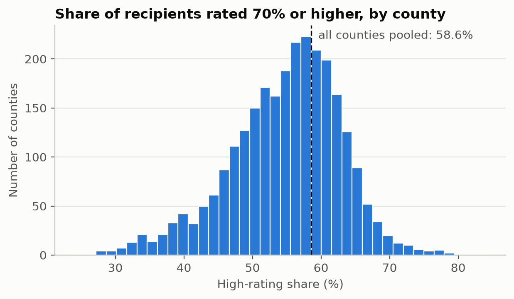
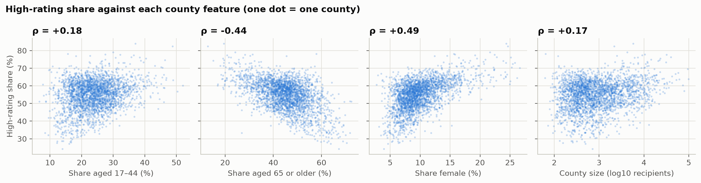
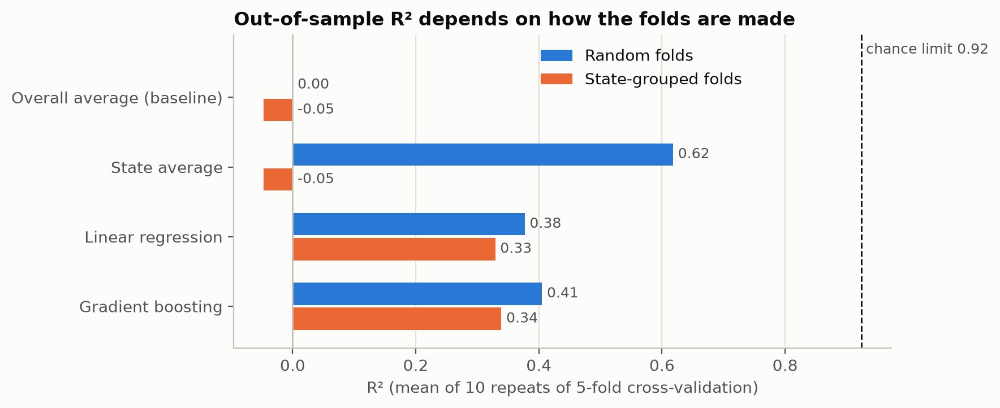

# County-Level Severity Mix of VA Disability Compensation

**Status:** analysis complete · **Last run:** 2026-11-11 · **Author:** _your name, supervisor, institution_

## Abstract

This small project uses a county-level table of US veterans' disability compensation recipients (3,144 counties, 6.2 million recipients) split by disability rating band, age band and sex. It studies one outcome: the **high-rating share** of a county, i.e. the proportion of its recipients rated 70% or higher. Across all counties pooled the share is **58.6%**, but it ranges from about 40% to 66% between counties (5th to 95th percentile), and this spread is far larger than chance: only about 8% of the between-county variance can be sampling noise. About 63% of the variance lies between states (Minnesota 37.9%, North Carolina 66.0%). A county's age mix, female share and size predict the share with **R² = 0.41 under random cross-validation but 0.34 when whole states are held out**, so part of the apparent accuracy comes from having neighbouring counties of the same state in training.

## Research questions

| | Question | Answer |
|---|---|---|
| RQ1 | How much does the high-rating share differ between counties and states? | A lot. County SD is 8.1 points against 2.2 expected from chance (chi-square p < 0.001). 63% of the variance is between states |
| RQ2 | Is it related to age mix, female share and county size? | Yes for age mix and female share; no for size once the others are held fixed |
| RQ3 | Can those features predict the share in an unseen state? | Partly: R² 0.34, mean error 5.2 points against 6.5 for the baseline. Random folds overstate this (R² 0.41) |

The hypotheses were written in the notebook before the results were produced; all three are supported.

## Results

### RQ1 — Variation

| | |
|---|---|
| Pooled high-rating share | 58.6% |
| County shares: 5th percentile / median / 95th percentile | 39.5% / 55.8% / 66.2% |
| Observed SD of county shares | 8.1 points |
| SD expected from chance alone | 2.2 points |
| Variance that is not chance (upper limit for any model's R²) | 92.4% |
| Variance lying between states | 63.3% |
| Lowest states | Minnesota 37.9%, Nebraska 44.9%, Indiana 45.4% |
| Highest states | North Carolina 66.0%, Texas 65.4%, Nevada 65.1% |



All states are ranked in [results/fig_02_state_ranking.png](results/fig_02_state_ranking.png) and [results/table_03_state_high_share.csv](results/table_03_state_high_share.csv).

### RQ2 — Related features

| County feature | Spearman ρ (95% CI) | Linear model: points per 1 SD, other features fixed (95% CI) |
|---|---|---|
| Share aged 17–44 | +0.18 (0.04 to 0.30) | −3.5 (−4.9 to −2.2) |
| Share aged 65 or older | −0.44 (−0.54 to −0.32) | −5.7 (−8.0 to −3.3) |
| Share female | +0.49 (0.36 to 0.59) | +2.0 (1.0 to 3.1) |
| County size (log recipients) | +0.17 (0.06 to 0.28) | 0.0 (−0.7 to 0.9) |

Confidence intervals resample whole states (2,000 cluster-bootstrap resamples).

- Counties with an older recipient population have a lower high-rating share; counties with more female recipients have a higher one.
- The 17–44 share changes sign between the two columns. Alone it is weakly positive; with the 65+ share held fixed, a higher 17–44 share means a lower 45–64 share, and the result is negative. Read together, the two age coefficients say the high-rating share is highest where the **45–64 group** is largest.
- County size has no effect of its own once age and sex mix are accounted for.



### RQ3 — Prediction and fold design

| Predictor | R², random folds | R², state-grouped folds | Mean error, state-grouped (points) |
|---|---|---|---|
| Overall average (baseline) | 0.00 | −0.05 | 6.53 |
| State average (no county feature) | 0.62 | −0.05 | 6.53 |
| Linear regression | 0.38 | 0.33 | 5.30 |
| Gradient boosting | 0.41 | 0.34 | 5.25 |

Mean of 10 repeats of 5-fold cross-validation. The grouped score was lower than the random score in all 10 repeats for both models.

- Simply knowing the state (R² 0.62) beats both models that use county features (R² ≤ 0.41). The state a county is in carries more information than its age and sex mix.
- For a state the model has not seen, the four features explain about a third of the variance. Gradient boosting is not meaningfully better than linear regression.



### Sensitivity checks (gradient boosting, state-grouped R²)

| Check | Counties | R² |
|---|---|---|
| Main analysis | 2,674 | 0.34 |
| Without female share, larger sample | 2,923 | 0.29 |
| Only counties with 500+ recipients | 1,638 | 0.36 |
| Outcome = share rated 100% | 2,674 | 0.36 |

## Limitations

- **No denominators.** The file has no population or veteran counts, so nothing here is a rate per resident or per veteran. Every result is about the mix of people who already receive compensation.
- **Counties, not people.** These are associations between county-level shares. They do not show that older or female veterans individually receive lower or higher ratings (ecological fallacy).
- **Hidden small cells.** Counts below 10 are blank in the source. 470 small counties (median 67 recipients) are left out of the main analysis; they hold 0.6% of recipients, so pooled figures are barely affected, but conclusions do not cover very small counties.
- **Source and year not confirmed.** The file arrived without documentation. See [data/DATA_CARD.md](data/DATA_CARD.md).
- **No explanation of the state differences.** The gap between states is large (Minnesota is 7 points below the next state) and this dataset cannot say why. It deserves a check against the original source before being quoted.
- **One snapshot.** No time dimension, no external validation set.

## Method

| Step | What is done |
|---|---|
| Data | 3,144 county rows; 4 non-county rows (Puerto Rico total, other territories, foreign, unknown) excluded |
| Cleaning | Thousands separators removed; blank cells kept as missing, never filled in |
| Outcome | (rated 70–90% + rated 100%) ÷ total recipients |
| Features | Share aged 17–44, share aged 65+, share female, log10 of total recipients |
| Leakage control | Other rating bands and the 45–64 share are not used as features (they sum to 100% with the outcome or with other features) |
| Variation | Observed variance against binomial variance; chi-square test of equal shares |
| Association | Spearman correlation and standardised linear coefficients; state cluster bootstrap for 95% CIs |
| Prediction | Baseline, state average, linear regression, gradient boosting; fixed settings, no tuning |
| Validation | 5-fold CV × 10 repeats, random folds and state-grouped folds reported side by side |
| Seed | 42 |

## Structure

```
02-va-disability-county-severity/
├── README.md
├── requirements.txt
├── data/            raw CSV (read-only) and DATA_CARD.md
├── notebooks/       va_disability_county_severity.ipynb  (48 small tasks, one per cell)
└── results/         4 figures (PNG) and 9 tables (CSV) written by the notebook
```

## Reproduce

```bash
cd 02-va-disability-county-severity
python3.11 -m venv .venv && source .venv/bin/activate
pip install -r requirements.txt
cd notebooks && jupyter lab va_disability_county_severity.ipynb     # Run All, about 1.5 minutes
```

## Ethics

The data are aggregate counts with small cells already suppressed; no individual can be identified. Results describe counties and must not be used to judge individual claims or veterans.
