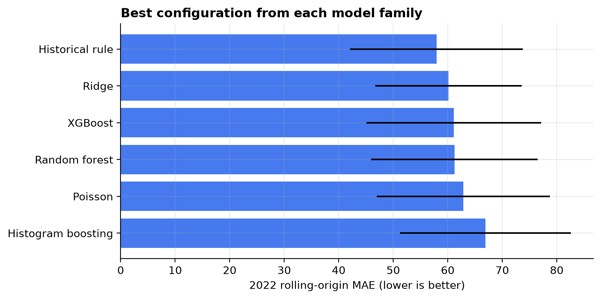
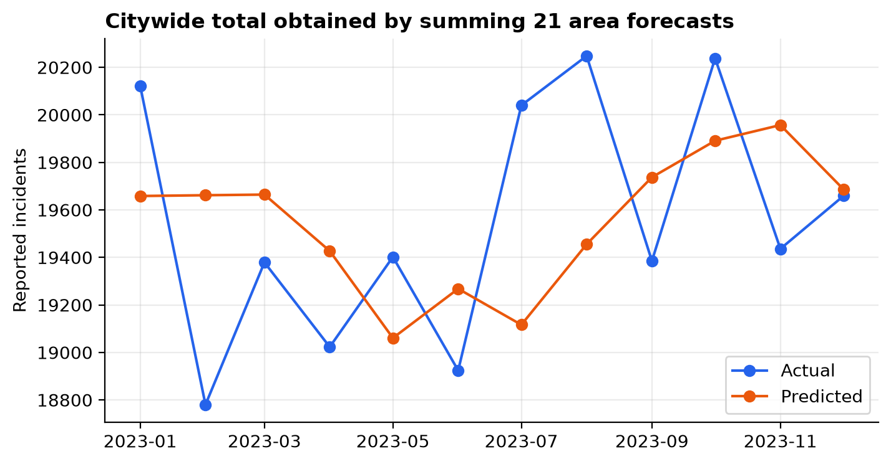
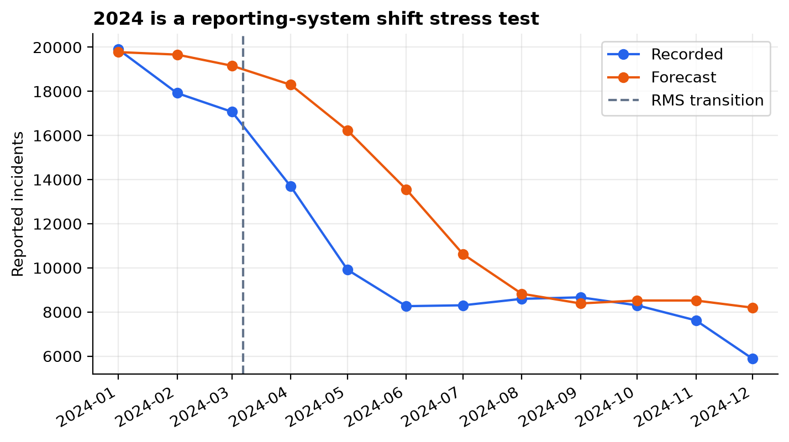

# Leakage-Resistant Monthly Crime-Report Forecasting for LAPD Areas

**Status:** analysis complete · **Last run:** 2026-11-14 · **Author:** Abdur Rahman

## Abstract

This project asks whether past incident counts can forecast the next month's number of crimes **reported** in each of 21 LAPD areas. The supplied file contains 1,004,894 incident rows. Reports dated 2020–2024 are aggregated to area-months; no victim attribute, crime label, precise location or case outcome enters a model. Six model families are compared with 12 expanding-window forecast origins in 2022 and equal four-configuration budgets for each trainable family. The transparent trailing 3-month mean wins validation (MAE 57.93 incidents per area-month), ahead of tuned Ridge (60.11), XGBoost (61.11), random forest (61.24), Poisson regression (62.87) and histogram boosting (66.94). In the 2023 evaluation it achieves MAE **48.98**, WAPE **5.26%**, a WAPE-based forecast score of **94.74%**, **R² 0.891**, and RMSE **61.58**. Its MAE is 21.83 lower than seasonal naive (month-block bootstrap 95% CI 12.41–32.95). A March 2024 LAPD records-system transition breaks continuity: legacy-file stress-test MAE rises to 122.01 and WAPE to 22.93%. The 2024 decline is treated as measurement shift, not a real crime decline.

## Research question and answer

**Question:** Can historical monthly counts forecast next-month reported-incident counts for the same LAPD areas?

**Answer:** Yes, at this coarse spatial and temporal scale, but a simple recent-history rule generalizes better than the tested machine-learning models. The result supports a parsimonious operational forecast, not predictive policing and not a model of true or unreported crime.

## Model comparison

| Best configuration in each family | 2022 rolling MAE | 2022 WAPE |
|---|---:|---:|
| **Trailing 3-month mean** | **57.93** | **6.21%** |
| Ridge (`alpha=100`) | 60.11 | 6.45% |
| XGBoost (`depth=2`, `rate=0.03`) | 61.11 | 6.55% |
| Random forest (`depth=12`, `leaf=1`) | 61.24 | 6.58% |
| Poisson regression (`alpha=0.1`) | 62.87 | 6.76% |
| Histogram boosting (`31` leaves, L2 `1`) | 66.94 | 7.17% |

The seasonal-naive rule's validation MAE is 121.30. The printed family comparison is saved in [table_04_model_comparison.csv](results/table_04_model_comparison.csv); all 24 tried configurations, including weaker ones, remain in [table_03_all_validation_configs.csv](results/table_03_all_validation_configs.csv).

## Final 2023 evaluation

| Metric | Result |
|---|---:|
| MAE | **48.98 incidents per area-month** |
| WAPE | **5.26%** |
| WAPE-based forecast score (`100% − WAPE`) | **94.74%** |
| R² | **0.891** |
| RMSE | 61.58 |
| Mean Poisson deviance | 3.96 |
| Approximate 90% residual-interval coverage | 95.24% |
| MAE improvement over seasonal naive | 21.83 (95% month-block bootstrap CI 12.41–32.95) |





The interval is a diagnostic rather than a formal guarantee: only 12 rolling validation months are available and the 21 area observations within a month are dependent.

### How to interpret the 94.74% figure

The **94.74%** value is `100% − WAPE`, included as an intuitive forecast score. It means that total absolute forecast error equals 5.26% of the total recorded count. It is **not classification accuracy** and should not be compared with accuracy values from classification papers. MAE and WAPE remain the primary evaluation metrics; R² is reported as a standard secondary regression metric.

## 2024 reporting-system stress test

LAPD's official portal says it adopted a new records-management system on 7 March 2024 while transitioning to NIBRS. The supplied legacy file falls from 234,636 reports in 2023 to 134,104 in 2024. Forecast MAE rises to **122.01** and WAPE to **22.93%**.



This is evidence that the data-generating/measurement process changed. It is not evidence that crime fell by the same amount, and the model should not be deployed across the transition without rebuilding the series from current NIBRS data.

## Method

| Step | Decision |
|---|---|
| Time axis | `Date Rptd`, because it represents when information becomes operationally available |
| Target | Incident rows per LAPD area and calendar month |
| Predictors | Area, time trend, cyclical month, lags 1/2/3/6/12, past-only rolling mean 3/6/12 and rolling SD 6 |
| Leakage control | Every lag/rolling statistic is shifted; validation months are later than their training rows |
| Model selection | 12 expanding monthly origins in 2022; lowest mean monthly MAE |
| Candidate budget | Four configurations for every trainable family |
| Evaluation | 2023 after model selection; 252 area-month forecasts |
| Uncertainty | Approximate 90% interval from 2022 out-of-time absolute residuals |
| Comparison uncertainty | 5,000-resample paired bootstrap of the 12 test months |
| Stress test | Refit through 2023 and forecast the structurally changed 2024 legacy file |

## Why the simple model won

There are only 24 usable pre-evaluation months after creating a 12-month lag, although each month contains 21 areas. Area counts are locally stable, so the recent mean captures most useful signal. More flexible models have little independent temporal history from which to learn nonlinear patterns. Selecting XGBoost because it is fashionable would therefore reduce validation performance and weaken the defense.

## Limitations

- Reports are not all crimes: reporting behaviour, police activity and administrative practice shape the data.
- Only one city, one legacy system and 21 large areas are studied; there is no external city validation.
- The COVID-19 period is part of the short training history.
- The 2023 evaluation has only 12 forecast months. Areas within a month are correlated, so 252 rows are not 252 independent replications.
- The residual interval is approximate under temporal and spatial dependence.
- Model development was not externally preregistered; the repository timestamp documents the analysis but does not make it confirmatory evidence.
- No weather, mobility, population or socioeconomic covariates are available. Deep models used in finer-resolution published studies therefore do not form a fair numerical benchmark.
- LAPD's 2024 system transition makes the legacy file unsuitable for uninterrupted trend claims.
- Place-based forecasts can reproduce reporting and enforcement bias. These results must not be used to allocate patrols or label communities.

## Project structure

```text
03-lapd-area-crime-forecasting/
├── README.md
├── requirements.txt
├── data/
│   ├── raw/CrimeData.csv
│   └── DATA_CARD.md
├── notebooks/
│   ├── lapd_area_crime_forecasting.py
│   └── lapd_area_crime_forecasting.ipynb
├── research/
│   ├── research_plan.md
│   ├── literature_review.md
│   ├── references.md
│   └── defense_notes.md
└── results/       # six figures, twelve tables, and audit.md
```

## Reproduce

```bash
cd 03-lapd-area-crime-forecasting
python3.11 -m venv .venv
source .venv/bin/activate
pip install -r requirements.txt
python ../tools/make_notebook.py notebooks/lapd_area_crime_forecasting.py notebooks/lapd_area_crime_forecasting.ipynb --run
```

Run from the project directory so the notebook's relative paths resolve. The delivered notebook has 49 code-only cells, no markdown cells, and was executed top to bottom.

## Responsible use

This is an academic forecasting exercise, not a policing product. Consult the [data card](data/DATA_CARD.md), [literature review](research/literature_review.md), [defense notes](research/defense_notes.md) and [audit](results/audit.md) before interpreting or reusing the results.
