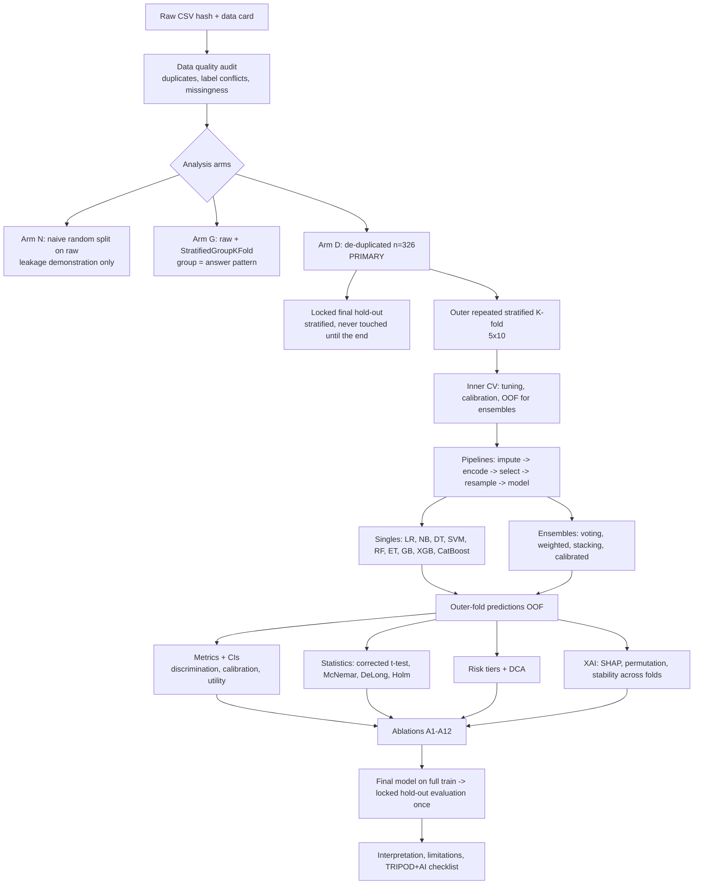

# 07 · Experimental Methodology

## 1. Workflow

## 2. Data preparation decisions
| Topic | Decision | Rationale |
|---|---|---|
| **Primary dataset** | **Arm D: de-duplicated (n=326)** evaluated with stratified repeated CV; Arm G reported alongside | If rows are replicas, Arm D is honest; if they are independent people, Arm G with respondent weights is closer to the population. Decide *before* modelling and report both |
| Duplicate handling | Group = identical answer pattern (9 predictors). In Arm G all rows of a group stay in one fold | Prevents identical rows in train and test |
| Label-conflict | Count patterns with both labels; report as noise estimate | Irreducible-error ceiling |
| Missing | Imputation **inside** pipeline (most frequent) + missing-indicator variant | <2% missing; indicator checks informative missingness |
| Encoding | Explicit mapping (file 05 §4); one-hot / native categorical variants | Avoid alphabetical codes |
| Scaling | Only for SVM/LR (after one-hot, scaling is usually unnecessary) inside pipeline | Fit on training fold only |
| Outliers | Not applicable (categorical) | State explicitly |
| Feature selection | Inside CV (L1, mutual information, SHAP-ranked forward selection) | Prevent selection bias |
| Imbalance | Prevalence 58–65%: class weights + threshold tuning as defaults; SMOTE-NC only as ablation, inside folds | Mild imbalance; SMOTE on categorical codes is questionable |
| Class distribution | Report per fold | Stratification check |
| Correlated features | Cramér's V / MI matrix; use VIF-free methods (regularisation) | Multicollinearity affects LR coefficients and SHAP |

## 3. Leakage-prevention checklist (§7.2 of the brief)
- [ ] Imputer, encoder, scaler, selector, resampler are all `Pipeline` steps fit only on training folds.
- [ ] SMOTE/SMOTE-NC via `imblearn.pipeline.Pipeline` (resamples only in `fit`).
- [ ] Hyperparameter search never sees outer-test or locked hold-out rows.
- [ ] Ensemble meta-learner trained on inner-loop OOF predictions only.
- [ ] Calibrator trained on inner-loop OOF predictions only (never on the outer test fold).
- [ ] Threshold/tier cut-offs chosen on inner OOF predictions; applied unchanged to outer test.
- [ ] Group-aware splitting for any arm containing raw duplicates.
- [ ] Final unbiased estimate from the locked hold-out only once, after all decisions are frozen.
- [ ] Feature set decisions (e.g., dropping the Suicide item) justified on inner results or on ethical grounds, not outer-test results.
- [ ] Random seeds fixed and logged; seed list reused across models.
- [ ] Automated tests: an assertion that no pattern appears in both train and test in grouped arms.

## 4. Data splitting strategy
| Option | Use here? | Trade-off |
|---|---|---|
| Single stratified hold-out | Only as the **locked final test** (e.g., 20% of unique patterns, n≈65) | High variance (±~10 pts), so never the sole evidence |
| Stratified k-fold | Inner loop | Standard |
| **Repeated stratified k-fold (5×10 or 10×5)** | **Outer loop** | Lower variance of the estimate; folds dependent → need corrected tests |
| **Nested CV** | Yes | Unbiased model-selection estimate [M: Varma & Simon 2006; Cawley & Talbot 2010]; compute cost manageable at n=326 |
| **StratifiedGroupKFold** | Arm G | Keeps identical patterns together |
| Temporal split | **No** (timestamps are survey-submission times, not postpartum time) | Misleading to call it temporal validation |
| Participant-level separation | Not possible (no participant ID) → group = pattern is a conservative proxy | Document |
| External validation | Not available | See `11`; search for a second public dataset with overlapping items |

A locked hold-out of n≈65 is small; consider using it only for the final headline number with a wide CI, or omit it and report nested-CV results as the main estimate (then say so).

## 5. Hyperparameter optimisation
| Method | Pros | Cons | Verdict |
|---|---|---|---|
| Grid search | Exhaustive, simple | Cost grows combinatorially | OK for LR/SVM (≤ 20 combos) |
| Randomized search | Efficient in high-dim spaces | Not adaptive | **Default for RF/ET/GB** |
| Bayesian/Optuna (TPE) | Sample-efficient, pruning | Extra dependency; overfitting the inner CV if many trials | **XGBoost/CatBoost** with fixed trial budget |

Policy: **identical budget per model family** (e.g., 50 trials or 15 min), inner objective = log-loss or AUC (state which; log-loss is preferred if calibration matters), 5-fold inner CV, seed fixed. Log every trial (study DB / CSV), search spaces in a config file, and the budget in the methods section.

Suggested search spaces (starting points, adjust after pilot): LR C∈[1e-3,1e2] log; RF/ET n_estimators 200–1000, max_depth 2–8, min_samples_leaf 1–10, max_features sqrt/log2; GB/XGB learning_rate 0.01–0.2 log, max_depth 2–4, n_estimators 100–600 with early stopping, subsample 0.6–1, reg_lambda 1e-2–10; CatBoost depth 2–6, l2_leaf_reg 1–10, iterations 200–800; SVM C 1e-2–1e2 log, gamma scale/1e-3–1.

## 6. Reproducibility
- Dependency lock file; Python and library versions in the report; `set seed` helper; `config.yaml` for all experiment settings; `run_manifest.json` (git commit, data hash, timestamp, versions); results saved as parquet/CSV with fold-level predictions; one command to regenerate all tables/figures; deposit code (and data if licence permits) in a public repository with archived DOI (Zenodo).

## 7. Rationale summary
| Stage | Why |
|---|---|
| Three data arms | Duplication is the biggest threat; quantifying it is itself informative |
| Nested repeated CV | n is small; single splits are unreliable |
| Pipelines for all preprocessing | Eliminates the most common leakage routes |
| Equal tuning budgets | Fair benchmark |
| Calibration before tiers | Tiers on uncalibrated probabilities are meaningless |
| Locked hold-out last | One honest final number |
